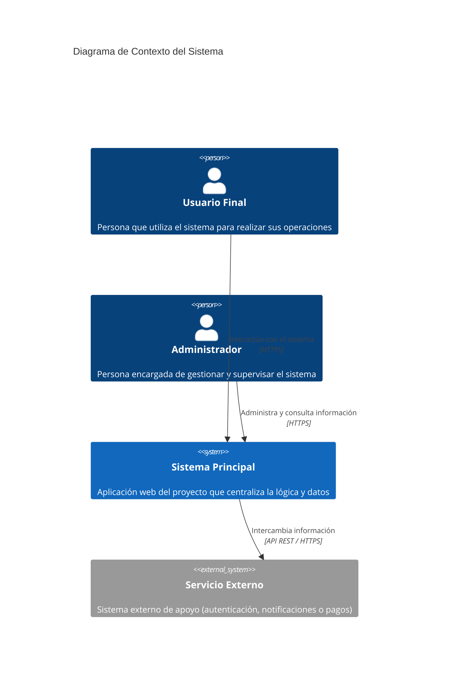
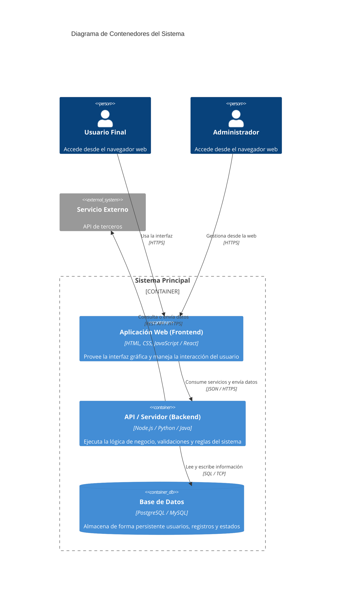

# Arquitectura del Proyecto - Modelo C4

## Nivel 1: Diagrama de Contexto

### Justificación - Nivel 1

En este nivel de contexto se muestra al sistema como una caja principal junto con los actores y sistemas externos con los que se relaciona. Los usuarios y administradores acceden mediante HTTPS para operar dentro de la plataforma, mientras que la integración con un servicio externo permite delegar funciones complementarias (como notificaciones o validaciones externas) sin mezclar responsabilidades ajenas al núcleo del sistema.

---

## Nivel 2: Diagrama de Contenedores

### Justificación - Nivel 2

Se dividió el sistema en tres contenedores principales para mantener una separación clara de responsabilidades:

* El **Frontend** se encarga únicamente de la presentación y experiencia del usuario en el navegador.
* El **Backend** concentra las reglas de negocio, autenticación y comunicación segura, evitando que la interfaz acceda directamente a los datos.
* La **Base de Datos** centraliza el almacenamiento persistente con integridad y consultas estructuradas.
* Las conexiones usan protocolos estándar (`HTTPS` con `JSON` entre cliente y servidor, y `SQL` hacia la base de datos) para facilitar el mantenimiento y la escalabilidad.